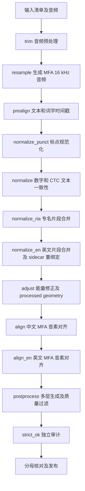

# 中文主管线和批量流式调度效率分析

分析日期：2026-09-30。范围按本次要求限定为中文主管线和批量流式调度。取证基于 `3b81053` 及当前工作树，保留已有未提交修改。本文记录已确认的重复工作、建议的合并边界和验收条件；尚未实施代码优化，也没有生产吞吐提升数据。

建议优先合并同一次收据提交中的文件扫描和摘要生成，并减少批量发布对已合并文件的重复哈希，然后统一批量调度下的 CPU 子池预算。四个规范化步骤可以进一步共享执行上下文，但必须保留转换顺序、阶段证据和单步恢复语义。模型常驻属于后续候选，需要真实音频对照，不能由本次合成探针直接证明等价。

## 当前流程

`scripts/run_pipeline.py` 的 `FULL_STEP_ORDER` 是当前执行顺序的依据；README 中的“8 步”描述不足以覆盖现在的完整流程。



主管线默认预对齐后端为 Qwen3 HF：参考文本模式生成时间戳，无参考模式先识别再对齐。名称为 `nvrasr_fallback` 的兼容路由仍存在，实际后端应以迁移后的配置和 producer receipt 为准，不能只依据调度器注释判断模型。

`ctc_ready` 从 `link` 开始导入既有 CTC 证据，随后执行四个规范化步骤，再执行 `resample → adjust → align → align_en → postprocess → strict_ok`。它的音频准备顺序与 full 路由不同，不能统一改成一条固定线而忽略音频轴收据。

批量 pipelined 模式已经具有 GPU 和 CPU worker 以及有界队列。需要预对齐的批次由 GPU phase 完成音频准备、预对齐及规范化，停止于 `normalize_en`；CPU phase 在同一批次工作区从 `resample` 恢复，继续边界修正、MFA、后处理及审计。已有 CTC 的批次使用导入路径。不能把“新增 GPU/CPU 流水线”或“删除 CPU 再跑一次 prealign”算作本次优化，因为现有代码已经进行了这层拆分。

关键源码定位：

| 内容 | 文件与符号 |
| --- | --- |
| 各模式步骤顺序 | `scripts/run_pipeline.py:6973`，`FULL_STEP_ORDER` 等 |
| 预对齐后端及证据复用 | `scripts/run_pipeline.py:2066`，`step_prealign` |
| GPU phase 结束点 | `scripts/streaming_pipeline.py:4374`，`_run_gpu_phase` |
| CPU phase 恢复点 | `scripts/streaming_pipeline.py:4529`，`_build_cpu_phase_command` |
| 资源规划器 | `scripts/streaming_pipeline.py:60`，`plan_streaming_resources` |

## 已确认的重复工作

### 规范化跳过仍触发大量文件读取

四个规范化步骤均调用 `_ensure_ctc_work`。即使 v4 marker 证明当前内容已规范化，各步骤仍调用 `_record_ctc_work_stage` 写入 skipped 记录。

当前调用关系为：

```text
每个 normalize 步骤
  _ensure_ctc_work
    validate_ctc_raw_manifest
    materialize_ctc_work
      再验证 raw
      验证已有 work，或首次物理复制及生成 receipt
    验证 freshness
    写入 freshness
  检查 normalization marker
  转换，或跳过转换
  _record_ctc_work_stage
    遍历 work，为 transform ledger 计算摘要
    write_ctc_work_receipt
      校验 raw，并为 work 文件重新计算摘要
    _write_ctc_work_freshness
      再遍历 work，并计算代码和依赖指纹
```

`_record_ctc_work_stage` 位于 `scripts/run_pipeline.py:1410`，freshness 生成位于 `:1343`，work receipt 生成位于 `scripts/pipeline_utils.py:981`。同一提交点需要的三种文件清单高度重叠，是可直接研究的合并目标。

本次使用临时目录建立 1、10、100 个 stem 的六文件 bundle、sealed raw manifest、producer receipt，以及有效 v4 normalization marker。首次创建 work 后连续调用四个生产规范化函数；全部返回 0，四步均走跳过路径。探针对实际导入的 `pipeline_utils` 模块及 `run_pipeline` 的 `_sha256_file` 计数，结果如下：

| stem 数量 | raw 文件哈希读取次数 | work 文件哈希读取次数 | 代码及其他文件哈希读取次数 | 单次耗时 |
| ---: | ---: | ---: | ---: | ---: |
| 1 | 129 | 176 | 33 | 0.0562 秒 |
| 10 | 885 | 1,472 | 33 | 0.1146 秒 |
| 100 | 8,445 | 14,432 | 33 | 0.9469 秒 |

每组代码及其他文件累计哈希读取约 10.8 MB。该探针计量的是生命周期和跳过路径的开销，使用小型合成文件，没有执行真实模型、MFA 或 NAS 读写；不是有效生产语料的端到端验收，也不是所有 I/O 的系统级统计。单次耗时不用于推算生产提升比例。

### 发布阶段反复读取已经合并的批次

`scripts/streaming_pipeline.py:1314` 的 `_copy_publication_tree` 会计算源文件清单，复制当前批次，然后重新扫描并计算整个目标目录的哈希。源码已经修复了“每个源文件扫描一次整树”的旧问题，但在 `:1851` 的 dataset 聚合循环中，每添加一个批次，仍会重新读取之前批次的文件。

本次直接调用生产复制函数的临时探针：10 个批次，每批 1 个不同名字的文件，累计目标文件哈希读取 55 次；各文件分别被读取 10、9、8、7、6、5、4、3、2、1 次。等大小批次下，该部分目标读取量随批次数呈三角数增长。这是操作次数证据，不是网络存储实测耗时。

单批 staging 也存在重复：`_copy_textgrid_tree` 和 `_copy_publication_tree` 已验证目标，`:1602` 再构建完整 staging 清单，重命名后 `:1626` 的 `_load_trusted_batch_evidence` 又读取产物验证证据。dataset 最终聚合再次读取这些 evidence 和产物。

建议让复制及校验返回本批已经验证的 manifest，供同一次 publication 事务生成 evidence；聚合时只核对本次迁移的目标文件，最后仍对完整目标目录执行独立验证。源和目标都需要内容校验，已有目标冲突、额外文件、symlink、内容篡改和恢复入口的全量验证不能被略过。尤其不能用复制前源摘要冒充目标写入后的验证结果。

### CPU 预算没有覆盖全部子池

`plan_streaming_resources` 按 `cpu_budget // cpu_workers` 限制中文和英文 MFA 的 jobs。其他子池仍有各自的自动值：

| 子任务 | 当前行为 | 证据 |
| --- | --- | --- |
| CTC adjust | 根据主机 CPU 数和 stem 数计算；本地盘最多 32，网络盘最多 8 | `scripts/adjust_ctc_boundaries.py:772` |
| 英文 corpus 构建 | 默认最多 16 个 worker，显式配置可另设 | `scripts/align_english_mfa.py:1277` |
| 英文规范化 | 使用 `mfa_en.normalize_workers`，未设置时由子程序自动计算 | `scripts/run_pipeline.py:3368` |
| postprocess | 仅在配置为正值时显式传入 workers，否则使用子程序自动值 | `scripts/run_pipeline.py:5131` |

多个 batch worker 可以同时进入上述阶段，因此 MFA jobs 受控不代表整条流水线的 CPU 使用受控。预算应覆盖 GPU producer 中的 CPU 准备工作和 CPU consumer，避免只给 consumer 平分整台机器。具体 worker 数需要依据当前主机、批次数和阶段耗时确定，不能沿用历史机器核数。

### 每个 GPU 批次仍有独立子进程启动

`_run_gpu_phase` 为每批构建 `run_pipeline.py` 命令；`step_prealign` 再调用所选模型环境中的预对齐程序。因此批间无法通过现有 Python 进程自然共享模型对象。模型加载开销是否处于关键路径，需要分开记录模型初始化、推理、排队及 CPU 后续耗时。

模型常驻可以减少启动次数，但不能同时改变 batch grouping、推理精度、解码参数或样本顺序，再把输出变化解释成等价优化。首次试验应只复用模型生命周期，保持逐条调用方式。

## 已有优化和必须保留的边界

后处理已经有批级 CTC 生命周期预检、token 行预加载、RMS 帧缓存、派生层提交和有界原子报告写入。对应 `_preflight_ctc_lifecycle_batch`、`_commit_derived_barriers`、`_run_bounded_postprocess`、`_verify_ctc_lifecycle_end` 都有生产调用及专项测试。本次不把这些已有能力重新列为待实现收益。

以下边界是“输出效果不变”的组成部分：

1. `ctc_pretg` 是 immutable raw；`ctc_pretg_adj` 是物理复制得到的 mutable work，不能用 hardlink 或 symlink 合并。
2. 四个规范化转换保持原顺序。特别是 `step_normalize_text` 在 marker 检查前还会执行 Qwen contextual pinyin projection；不能见到 marker 就整体返回。
3. `.lab` 的拼音声调数字不是普通文本数字。RIA 和英文合并需要同步 token、TextGrid、lab 和最终 sidecar 定位。
4. adjust 的 processed geometry 是下游消费契约；即使关闭能量修正，仍有 geometry-only 工作，不能直接移除阶段。
5. MFA 参数、词典、音频轴、分片和单条重试行为保持；本次不通过改变 beam、dither、fine-tune 或过滤阈值提速。
6. 后处理过滤和独立 strict audit 保持独立判定，不能让最终审计直接信任 producer 的“通过”布尔值。
7. source、eligible、output、filtered 集合和失败原因要一致。`--step`、`--skip-to`、`--stop-after`、部分失败及恢复行为仍可用。
8. `overwrite` 当前会影响 work 重新物化；`_refresh_ctc_work_pending` 则显式只刷新一次。合并步骤时必须分别覆盖两种语义，不能擅自把它们当成同一种缓存策略。

## 合并方案比较

| 方案 | 内容 | 输出等价验证难度 | 建议 |
| --- | --- | --- | --- |
| A 同一提交点及发布清单合并 | 同一稳定文件状态生成一次清单，供 ledger、work receipt、freshness 使用；发布复用本批清单；统一子池预算 | 较低，能比较规范化产物、发布内容及收据投影 | 第一轮优先 |
| B 规范化执行组 | 四个逻辑步骤共用执行上下文和文件索引，按原顺序更新；保留四个逻辑检查点及单步入口 | 中高，需覆盖中途失败、停止和 resume | A 的基线通过后实施 |
| C 模型常驻及调度重构 | 每卡模型进程跨批复用，配合批大小和队列调平 | 高，需要真实模型、隔离和故障恢复对照 | 有计时证据后单独推进 |

第一轮推荐的内部结构是：

```text
已有步骤入口
  → 校验当前输入
  → 执行原有转换
  → 收集本次提交的文件清单
       ├─ transform ledger 所需摘要
       ├─ work receipt 所需文件记录
       └─ freshness 所需输出指纹
  → 原子写入收据
  → 保留后续阶段及独立审计的验证
```

共享清单只在一个明确提交点内使用，不建立跨运行或跨独立审计的全局“已验证”缓存。路径和 mtime 不能单独作为内容身份。缺失、替换、symlink、额外文件或原始清单变化必须继续失败关闭。

B 方案的目标是减少执行开销，不删除逻辑阶段。单步命令仍执行原步骤；连续运行时才进入共享执行组。变换记录的阶段名、次序、中间摘要和最终 sidecar 绑定均需保留。若无法证明与某个恢复分支等价，该分支保持原执行路径。

## 验收条件

“输出效果不变”采用可比较的产物和错误行为定义，不能只比较通过率：

| 验收对象 | 条件 |
| --- | --- |
| 音频 | 输出 WAV 字节、采样率、帧数、音频轴和变换收据一致 |
| CTC | 六类产物内容、规范化顺序、token 顺序及边界一致；raw 完全未变 |
| MFA | 使用相同模型、词典、命令参数、分区和重试策略；对齐标签及边界一致 |
| 最终输出 | 相同 stem 集合、tier 名称、标签、顺序及边界；过滤集合和结构化原因一致 |
| 收据 | 阶段 lineage、输入输出哈希和分母完整；只允许显式解释的新 run 路径、代码身份、诊断计时等差异 |
| 恢复 | 冷启动、暖恢复、单步、skip-to、stop-after、overwrite 和 refresh 分支均有对照 |
| 失败关闭 | 篡改 raw/work/receipt、丢文件、额外文件、跨分区缓存、worker 失败不能产生成功发布 |
| 性能 | 固定样本清单及环境，区分冷启动和暖恢复，至少三次交错运行比较 wall time 中位数及资源峰值 |

先在新工作区做旧版和候选版本 A/B，保存配置、模型、词典、源音频和 stem 清单的身份。使用现有 `compare_alignment_runs.py` 辅助比较，再补齐它未覆盖的中间产物和失败分区比较。任何允许的元数据差异必须列白名单，不能统一忽略全部 receipt 或 hash 字段。

性能记录应覆盖 staging、模型初始化与推理、normalize、adjust、中文 MFA、英文 MFA、postprocess、strict audit、发布和队列等待。现有阶段总耗时不足以确定真正关键路径，因此当前不给出端到端提速百分比，也不直接改生产 batch size。

## 实现前验证基线

中文专项测试执行命令：

```bash
PYTHONDONTWRITEBYTECODE=1 python -m pytest -q -p no:cacheprovider \
  tests/test_ctc_artifact_versions.py \
  tests/test_run_pipeline_normalize_ria.py \
  tests/test_run_pipeline_subset_denominator.py \
  tests/test_streaming_ctc_cache_isolation.py \
  tests/test_streaming_checkpoint_contract.py \
  tests/test_streaming_publication_contract.py \
  tests/test_mfa_retry.py \
  tests/test_mfa_sharded_axis_links.py \
  tests/test_compare_alignment_runs.py
```

结果：179 passed，3.55 秒。另行执行 `tests/test_streaming_publication_copy.py`，结果为 3 passed，0.10 秒。此前执行的 `test_postprocess_efficiency.py`、`test_postprocess_efficiency_integration.py`、`test_streaming_resources.py` 也通过。它们证明当前相关契约测试可作为基线，不代表候选优化已通过，更不代表真实 GPU/MFA 端到端验收。

用户随后确认“实现优化”，本轮按方案 A 实施；以下记录实现及候选版本验证。B、C 保持后续独立评估范围。


## 已实施的合并和资源控制

1. **CTC 同一次提交共用摘要。** `CtcWorkCommitSnapshot` 在转换完成后捕获文件清单，
   ledger、work receipt 和 freshness 共用其中的内容摘要。文件仍以 SHA-256 标识；
   提交前核对文件身份、大小、mtime、ctime、类型和完整清单，拒绝捕获后的变化。
   普通子目录沿用旧版忽略规则，可选 ref 和顶层 metadata 保持原来的摘要投影。
   采用 `scandir/lstat` 减少路径解析开销，没有跨运行摘要缓存。
2. **发布复用本批和已受信清单。** staging evidence 复用复制时的 manifest；聚合复用
   已经独立校验的批次 manifest，不再为复制重复哈希 staging 源文件，也不再逐批
   哈希累计目标的旧 sibling。目录清单及符号链接检查保留。rename 后仍独立验证 staging，
   最后完整比较终态 output/filtered 与批次证据并集；恢复 COMPLETE 同样核验终态内容。
   这同时修复了旧版只核对 stem、无法发现同名终态改写的问题，见回归 Case 259。
3. **辅助池共用 CPU 预算。** `--cpu-budget` 从调度器传到主管线及各阶段，按工作量、
   阶段上限和每 worker 预算截断辅助池。流水调度使用 FIFO 加权额度，GPU 阶段默认
   占 1 份，CPU 阶段占原 MFA jobs、英文 MFA jobs 与辅助池额度的最大值；队列操作
   在额度占用区间之外，取消或异常会释放额度。原批量 MFA jobs 和分片规划保持。

规范化四步的算法、顺序与逻辑检查点保持；本次合并的是同一次提交中的重复清单生成。
模型、词典、声学参数、音频轴、过滤规则以及独立 strict audit 未作改动。

## A/B 局部基准

使用 100 个合成 stem、四个规范化跳过步骤和 10 个单文件发布批次，在同一临时路径
交错运行旧版/新版三轮。逐项比较 work 文件、最终复制文件的 SHA-256 和收据字段；
仅排除代码修改必然改变的 `receipt.identity`、`fingerprints.producer` 与
`fingerprints.digest`，其余字段全部相同。

| 指标 | 旧版 | 新版 |
| --- | ---: | ---: |
| 单次 CTC commit 的每个 work 文件哈希 | 3 次 | 1 次 |
| 四步 skip 路径 work 文件哈希总数 | 14,432 | 9,624 |
| 四步 skip 路径 raw 文件哈希总数 | 8,445 | 8,445 |
| 四步 skip 路径耗时中位数 | 0.853 秒 | 0.800 秒 |
| 10 批复制阶段目标文件哈希总数 | 55 | 10 |
| 10 批复制阶段耗时中位数 | 5.123 毫秒 | 3.973 毫秒 |
| 聚合阶段每个 staging TextGrid 的源哈希 | 2 次 | 1 次 |

前六项由 `tests/benchmark_pipeline_efficiency.py` 实测；最后一项由真实临时文件的
聚合回归测试计数验证。完整三轮记录见
[`benchmarks/2026-09-30-cn-pipeline-efficiency.json`](benchmarks/2026-09-30-cn-pipeline-efficiency.json)。

基准命令：

```bash
PYTHONDONTWRITEBYTECODE=1 python tests/benchmark_pipeline_efficiency.py \
  --baseline-scripts /tmp/mfa-efficiency-baseline-cv4xdbs6/scripts \
  --output /tmp/mfa-efficiency-results.json
```

基线为本次改动前保存的脚本副本（HEAD `3b81053`，包含当时已有的工作区修改）。
复制耗时不含最后的 dataset 完整核验。以上是本地小文件局部基准，未运行真实 GPU/MFA
模型或 NAS 生产任务，因此不能推导端到端提速比例，也不证明真实模型全量结果已经复验。

## 最终回归与审阅

候选版本全量测试：**1,775 passed，37 skipped，1 failed，37.72 秒**。
唯一失败为 `tests/test_ja_independent_verifier.py::test_three_uid_bound_fixture_integrity_and_evidence_tamper`，
改动前全量基线已出现相同失败（1,723 passed，37 skipped，1 failed）。它属于日语
fixture/evidence 契约，不在本次中文优化范围内，未改动该夹具或日语生产代码。

全量运行后补充真实调度入口的 1 核/8 核测试（阶段执行以测试替身代替模型）：
有界队列中 8 个批次全部经过 GPU/CPU 阶段，核对实际重叠额度不超过预算、MFA jobs
保持原规划值、完成后额度归零；**2 passed**。合计验证通过 1,777 项，其中新增回归 54 项。

```bash
PYTHONDONTWRITEBYTECODE=1 python -m pytest -q -p no:cacheprovider tests --tb=short
PYTHONDONTWRITEBYTECODE=1 python -m pytest -q -p no:cacheprovider \
  tests/test_streaming_resources.py -k admission_bounds
```

独立审阅已覆盖 CTC 提交、发布清单复用、额外 metadata 拒绝、默认预算下传及加权调度，
没有剩余阻断项；`git diff --check` 通过。改动保留在当前工作区，未提交或推送。
